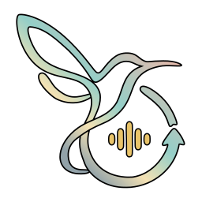
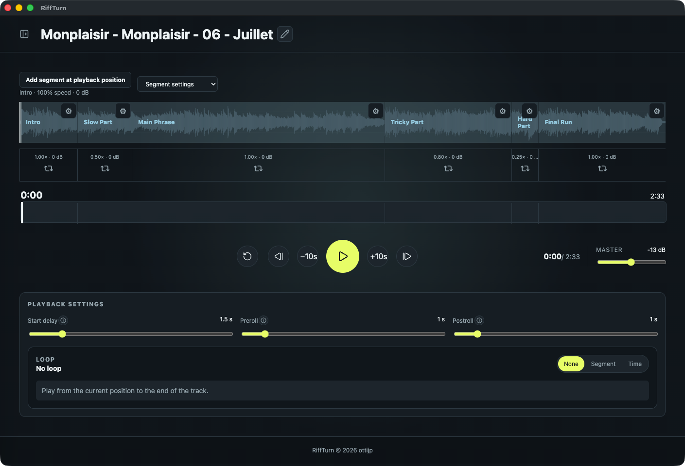

<center></center>

# RiffTurn

日本語 | [English](README.md)

RiffTurnは，音源の好きな部分を繰り返し再生して練習できるデスクトップアプリです．

**RiffTurnはまだβ版です．UIは今後大きく変更される可能性があります．また，作者はmacOSを利用しているため，WindowsとLinuxでの動作テストは十分に行っていません．使い方の説明もまだ用意していません．**



## ダウンロード

[リリースページ](https://github.com/ottijp/riffturn/releases)からお使いのOSのパッケージをダウンロードして利用してください．

## モチベーション

最近ギターを始めて，難しいパートを繰り返し再生しながら練習するためのアプリが必要になりました．そこで，自分のペースでフレーズを練習できるようにRiffTurnを作りました．

## 機能

- ローカルの音源を読み込み，セグメントを作成して，セグメントごとに再生速度と音量を調整できます．
- セグメントの範囲または指定した時間範囲をループ再生できます．
- ループ再生の開始前に待ち時間を設けられます．（アプリを操作してから楽器を持つまで，また再ループ時の猶予時間）
- ループ範囲の前後を数秒余分に再生できます．（プリロール・ポストロール）

## データの管理

- 読み込んだ音源はコピーせず，元の場所から再生します．音源を移動または削除した場合は，再リンクが必要になります．
- バンドルされているサンプル音源は，初回起動時にOSのアプリケーションのデータディレクトリへコピーして管理します．プロジェクトの設定も同じディレクトリ内のSQLiteデータベースに保存します．

## サンプル音源

バンドルされているサンプル音源には，[Monplaisir - 06 - Juillet · nullrights](https://nullrights.com/track/3gqt6bs0qc)を使用しています．CC0で公開してくれた作者に感謝します．

## 開発

```sh
npm install
npm run desktop:dev
```

### パッケージのビルド

```sh
# macOS arm64: dmgパッケージ
# コード署名と公証にはApple Developerの証明書と認証情報が必要です．
npm run desktop:build:mac
# Windows x64：NSISインストーラー
npm run desktop:build:win
# Linux x64：AppImageとDebianパッケージ
npm run desktop:build:linux
```

### 要件

- Node.js 24以降
- macOSパッケージの作成にはXcode Command Line Tools
- Windowsパッケージの作成にはWindows x64
- Linuxパッケージの作成にはDebianまたはUbuntuベースのLinux x64

### ライセンス

[MIT](LICENSE.txt)
